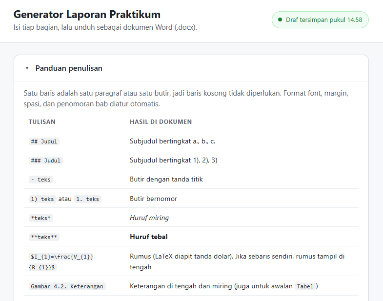
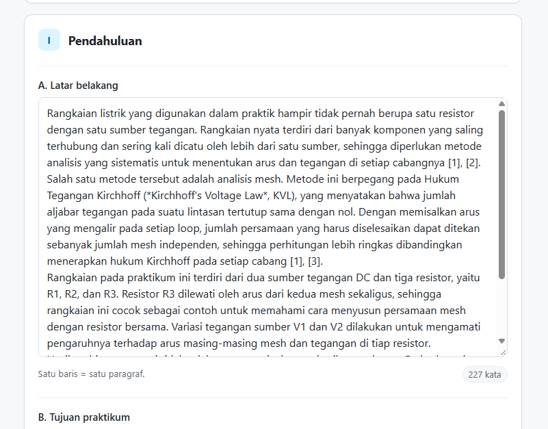
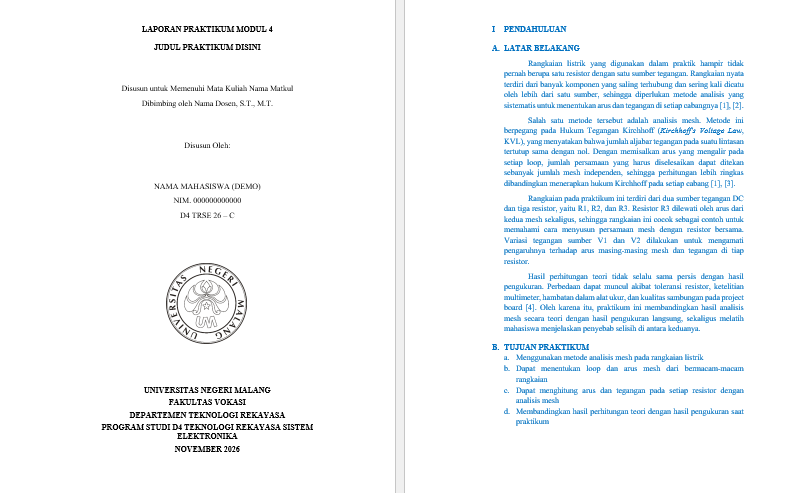

# Generator Laporan Praktikum

Aplikasi web untuk menyusun laporan praktikum menjadi dokumen Word (.docx) dengan format yang sudah diatur otomatis. Pengguna cukup mengisi tiap bagian laporan, lalu mengunduh hasilnya.

**Coba langsung:** https://rivanfathur-rgb.github.io/laporan-praktikum/

**Contoh hasil:** [PDF](docs/contoh-hasil.pdf) · [Word](docs/contoh-hasil.docx) (data dummy)

> **Catatan tentang format.** Format dokumen ini mengikuti aturan satu mata kuliah tertentu yang dipakai penulis, dan mungkin tidak sesuai dengan standar penulisan laporan praktikum secara umum. Jika dipakai untuk mata kuliah lain, periksa dulu aturan penulisan yang berlaku di sana.

## Tampilan

  
  

Hasil dokumen Word:

  

## Latar belakang

Mengatur format laporan praktikum di Word (penomoran bab, subjudul, indentasi, spasi, rumus) memakan waktu dan membuat hasil tiap orang berbeda-beda. Generator ini memisahkan isi dari format: pengguna hanya menulis isinya, sedangkan format mengikuti satu contoh laporan yang sama.

## Mengapa tidak ada hasil dan analisis?

Pada mata kuliah yang menjadi acuan, bagian **hasil percobaan (data) dan analisis ditulis tangan**, bukan diketik. Karena itu generator hanya membuat bagian yang memang diketik: sampul, Bab I (Pendahuluan), Bab II (Alat dan bahan), Bab III (Prosedur percobaan), Bab V (Penutup), dan Bab VI (Daftar pustaka).

Penomoran bab sengaja melompat dari III ke V, karena Bab IV (hasil dan analisis) tidak ada di dokumen yang dihasilkan. Tabel data percobaan juga tidak dibuat oleh generator karena alasan yang sama.

## Fitur

- Halaman sampul otomatis: nomor modul, judul, mata kuliah, dosen, nama, NIM, kelas, blok institusi, dan logo (opsional)
- Isi laporan: latar belakang, tujuan, dasar teori, alat dan bahan, prosedur, kesimpulan, dan daftar pustaka
- Format otomatis: Times New Roman 12 pt, spasi 1,15, margin kiri 4 cm dan lainnya 3 cm, penomoran bab dan subjudul bertingkat
- Penulisan sederhana: subjudul, butir, huruf miring dan tebal, rumus LaTeX, dan keterangan gambar
- Draf tersimpan otomatis di perangkat, dengan indikator draf dan penghitung kata di tiap kolom
- Semua diproses di browser dan tidak dikirim ke server

## Cara pakai

1. Buka halaman generator.
2. Isi bagian Sampul, lalu isi tiap bagian laporan.
3. Klik **Buat Laporan (.docx)**.
4. Buka file hasilnya di Word dan periksa. Gambar (misalnya gambar rangkaian pada prosedur) disisipkan manual di Word.

### Aturan penulisan

Satu baris adalah satu paragraf atau satu butir, jadi baris kosong tidak diperlukan.

| Tulisan | Hasil di dokumen |
|---|---|
| `## Judul` | Subjudul a., b., c. |
| `### Judul` | Subjudul 1), 2), 3) |
| `- teks` | Butir dengan tanda titik |
| `1) teks` atau `1. teks` | Butir bernomor |
| `*teks*` | *Huruf miring* |
| `**teks**` | **Huruf tebal** |
| `$I_{1}=\frac{V_{1}}{R_{1}}$` | Rumus; jika sebaris sendiri, tampil di tengah |
| `Gambar 4.2. Keterangan` | Keterangan di tengah dan miring (juga untuk awalan `Tabel`) |

Butir pada Tujuan dan Alat dan bahan otomatis diberi huruf (a, b, c), dan butir pada Kesimpulan diberi angka (1, 2, 3).

## Menjalankan di komputer sendiri

Tidak perlu instalasi. Unduh repo ini, lalu buka `index.html` di browser.

## Catatan dan batasan

- Warna teks isi (biru), ukuran huruf, spasi, dan margin mengikuti contoh laporan dari mata kuliah tersebut. Pengaturannya ada di bagian konfigurasi pada `app.js`.
- Rumus dibuat sebagai rumus inline, jadi pecahan tampil lebih kecil daripada rumus mode display di Word.
- Logo tidak ikut tersimpan di draf, jadi perlu dipilih ulang setelah halaman dimuat ulang.

## Rencana pengembangan

- Simpan dan muat draf sebagai file
- Pratinjau sebelum mengunduh
- Pemeriksaan otomatis, misalnya kutipan yang tidak ada di daftar pustaka
- Preset institusi

## Teknologi

HTML, CSS, JavaScript, dan pustaka [docx](https://github.com/dolanmiu/docx) (MIT) untuk membuat file Word.

## Struktur

- `index.html`: tampilan dan alur halaman
- `app.js`: logika pembuatan dokumen Word
- `vendor/docx.js`: pustaka docx
- `docs/`: contoh hasil dan gambar untuk README

## Lisensi

MIT. Lihat berkas [LICENSE](LICENSE).

## Pembuat

Muhammad Rivan Fathurozin ([@rivanfathur-rgb](https://github.com/rivanfathur-rgb))
